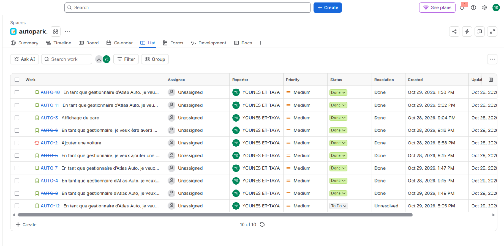

# AutoPark — Gestion de parc automobile

AutoPark est une application web pédagogique conçue pour **Atlas Auto**, une agence fictive de location de voitures. Elle permet de gérer les véhicules, leurs tarifs et leur disponibilité depuis une interface web.

Le projet utilise **HTML5, CSS3 et JavaScript Vanilla ES6+**, sans backend ni base de données. Les données sont conservées dans le navigateur avec **localStorage**.

## Liens du projet

- **Dépôt GitHub** : [younes-ettaya/AutoPark](https://github.com/younes-ettaya/AutoPark)
- **Application déployée** : à compléter après déploiement.
- **Tableau Jira** : à compléter.

## Les deux pages

| Page | Rôle |
| --- | --- |
| `voitures.html` | Consulter le parc et gérer les véhicules à partir du starter HTML/CSS. |
| `index.html` | Présenter le dashboard avec les compteurs Total, Disponibles, Louées et En maintenance. |

## État d’avancement

État établi à partir du code de la branche `developement` consulté le 30 octobre 2026. Les éléments présents dans le code ne constituent pas une validation complète de leur fonctionnement.

| Fonctionnalité | État |
| --- | --- |
| Affichage dynamique du tableau et badges de statut | Présent dans le code |
| Ajout d’une voiture | Présent, validations à compléter |
| Modification avec préremplissage et annulation | Présente dans le code, à tester |
| Suppression avec confirmation | Présente dans le code |
| Recherche par marque, modèle ou immatriculation | Présente, insensible à la casse |
| Sauvegarde et récupération avec localStorage | Présentes dans le code |
| Unicité des identifiants après rechargement | À sécuriser |
| Validation des espaces seuls, du prix et des immatriculations en doublon | À compléter |
| Messages d’erreur près des champs et états vides | À compléter |
| Filtres par catégorie et statut, tri numérique et réinitialisation | À implémenter |
| Combinaison de tous les critères | À implémenter et tester |
| Dashboard et quatre compteurs | À développer, `index.html` contient une structure vide |
| Modules communs pour le stockage et les deux pages | À organiser |
| Vérification responsive, accessibilité et déploiement | À finaliser |

## Fonctionnalités attendues

### Gestion des véhicules

- Afficher les voitures dans un tableau généré en JavaScript.
- Ajouter une voiture sans recharger la page.
- Modifier ses informations sans changer son identifiant.
- Annuler une modification en cours.
- Demander confirmation avant chaque suppression.
- Différencier visuellement les statuts.
- Afficher un message lorsque le parc est vide.

### Validation du formulaire

- Refuser les champs obligatoires vides ou composés uniquement d’espaces.
- Accepter uniquement un prix journalier strictement positif.
- Garantir une immatriculation unique, sans tenir compte de la casse ni des espaces autour.
- Permettre à un véhicule de conserver son immatriculation pendant une modification.
- Afficher les erreurs près des champs concernés.
- Confirmer l’ajout et réinitialiser le formulaire après validation.

### Recherche, filtres et tri

- Rechercher instantanément par marque, modèle ou immatriculation.
- Filtrer par catégorie et par statut.
- Trier les prix numériquement, par ordre croissant ou décroissant.
- Combiner recherche, filtres et tri.
- Réinitialiser les critères et signaler l’absence de résultats.

### Dashboard

Le dashboard doit afficher quatre indicateurs calculés depuis les données enregistrées :

| Indicateur | Calcul |
| --- | --- |
| Total | Nombre de véhicules du parc |
| Disponibles | Nombre de véhicules au statut `Disponible` |
| Louées | Nombre de véhicules au statut `Louée` |
| En maintenance | Nombre de véhicules au statut `En maintenance` |

Les compteurs sont actualisés à chaque ouverture ou rechargement de la page. La navigation doit permettre de passer facilement du dashboard à la gestion du parc.

## Technologies et outils

| Technologie ou outil | Utilisation |
| --- | --- |
| HTML5 | Structure et sémantique des pages |
| CSS3 | Styles externes et adaptation aux différents écrans |
| JavaScript Vanilla ES6+ | Logique métier, DOM et événements |
| Modules ES6 | Organisation du code avec `import` et `export` |
| localStorage et JSON | Persistance locale des véhicules |
| Git et GitHub | Versionnement, branches et Pull Requests |
| Jira | Planification et suivi des tâches |
| Serveur local | Exécution du projet et chargement des modules |

Aucun framework JavaScript, backend, système de base de données ou API externe n’est prévu.

## Structure actuelle des fichiers

| Chemin | Contenu |
| --- | --- |
| `index.html` | Structure initiale du dashboard à développer |
| `voitures.html` | Interface de gestion du parc |
| `css/style.css` | Styles de la page de gestion et règles responsive |
| `js/data.js` | Données initiales exportées |
| `js/voitures.js` | Affichage, événements, gestion des voitures et stockage actuels |
| `README.md` | Documentation du projet |

Pour finaliser l’organisation en modules, le stockage devra être séparé de l’affichage et réutilisé par les deux pages. Les éventuels nouveaux fichiers devront être ajoutés à cette documentation.

## Lancer le projet en local

### 1. Cloner le dépôt

```bash
git clone https://github.com/younes-ettaya/AutoPark.git
cd AutoPark
```

Pour travailler sur la branche de développement consultée :

```bash
git switch developement
```

### 2. Démarrer un serveur local

**Avec VS Code et Live Server**

1. Ouvrir le dossier `AutoPark` dans VS Code.
2. Installer l’extension Live Server si nécessaire.
3. Faire un clic droit sur `voitures.html`.
4. Choisir **Open with Live Server**.

**Avec Python, s’il est installé**

Depuis la racine du projet :

```bash
python -m http.server 8000
```

Selon l’installation, utiliser `python3` à la place de `python`.

Ouvrir ensuite :

- Dashboard, après son implémentation : [http://localhost:8000/index.html](https://younes-ettaya.github.io/AutoPark/)

Utiliser un serveur local plutôt qu’une ouverture directe des fichiers avec `file://`, afin de charger les modules ES6.

## Données d’un véhicule

| Propriété | Description |
| --- | --- |
| `id` | Identifiant unique généré automatiquement |
| `marque` | Marque du véhicule |
| `modele` | Modèle du véhicule |
| `immatriculation` | Immatriculation unique |
| `categorie` | Citadine, Berline ou SUV |
| `prixJour` | Prix journalier en DH, strictement positif |
| `statut` | Disponible, Louée ou En maintenance |

Aucune image de voiture n’est nécessaire. Le statut `Louée` est défini manuellement.

## Persistance locale

Le code actuel utilise la clé `data` dans localStorage.

- `JSON.stringify()` transforme le tableau de véhicules en texte avant la sauvegarde.
- `JSON.parse()` permet de récupérer le tableau au chargement.
- Les données initiales sont utilisées uniquement lorsqu’aucune sauvegarde n’existe.
- Chaque ajout, modification ou suppression déclenche une sauvegarde.
- Un tableau vide sauvegardé doit rester vide après rechargement.

Les données sont propres au navigateur et à l’origine du site. Changer de navigateur, de port ou d’adresse ne partage pas automatiquement le parc. Effacer les données du site supprime la sauvegarde locale.

## Organisation du travail

1. Analyser le starter, préparer le zoning du dashboard et créer les tâches Jira.
2. Initialiser le dépôt et préparer les modules.
3. Développer l’affichage, l’ajout et les validations.
4. Ajouter la modification, la suppression et la sauvegarde locale.
5. Combiner recherche, filtres et tri.
6. Construire le dashboard responsive et ses indicateurs.
7. Tester, déployer et finaliser la documentation.

Les fonctionnalités sont développées sur des branches dédiées, avec des commits décrivant les changements. Les Pull Requests doivent préciser l’objectif, les modifications et les vérifications effectuées. Mettre Jira à jour au fil de l’avancement.

## Vérifications avant livraison

Les cases ci-dessous sont à cocher après exécution des tests correspondants.

- [ ] Le tableau affiche correctement les données initiales ou sauvegardées.
- [ ] Un ajout valide apparaît immédiatement et persiste après rechargement.
- [ ] Les champs vides et les espaces seuls sont refusés.
- [ ] Les prix nuls, négatifs et non numériques sont refusés.
- [ ] Les doublons d’immatriculation sont refusés, même avec une casse différente ou des espaces autour.
- [ ] La modification conserve l’identifiant et autorise l’immatriculation du véhicule modifié.
- [ ] Annuler une modification ne change aucune donnée.
- [ ] Annuler une suppression conserve le véhicule.
- [ ] Les identifiants restent uniques après plusieurs ajouts et rechargements.
- [ ] La recherche, les filtres et le tri fonctionnent simultanément.
- [ ] Le tri des prix est numérique, par exemple 80, 100, 250.
- [ ] La réinitialisation des critères réaffiche le parc complet.
- [ ] Les messages distinguent un parc vide d’une recherche sans résultat.
- [ ] Un parc volontairement vidé reste vide après rechargement.
- [ ] Les quatre compteurs reflètent les données enregistrées.
- [ ] La navigation fonctionne entre les deux pages.
- [ ] Les pages sont utilisables sur mobile, tablette et ordinateur.
- [ ] Les champs, messages et boutons restent accessibles au clavier.
- [ ] La console ne présente aucune erreur pendant les parcours testés.

## Tableau Jira

Le tableau Jira permet de suivre les tâches et leur état d’avancement.




## Déploiement et livrables

L’application peut être hébergée sur un service de sites statiques. Lors du déploiement, conserver les chemins relatifs des fichiers CSS et JavaScript et vérifier l’accès aux deux pages.

Livrables attendus :

- Dépôt GitHub avec code source, commits significatifs et Pull Requests documentées.
- README actualisé avec les fonctionnalités réellement terminées et les instructions de lancement.
- Lien vers l’application déployée et fonctionnelle.
- Tableau Jira avec les tâches et leur état d’avancement.

## Périmètre

AutoPark couvre la gestion du parc et le suivi manuel de la disponibilité. L’authentification, la gestion des clients, les contrats, les réservations par dates et les paiements sont hors périmètre.
